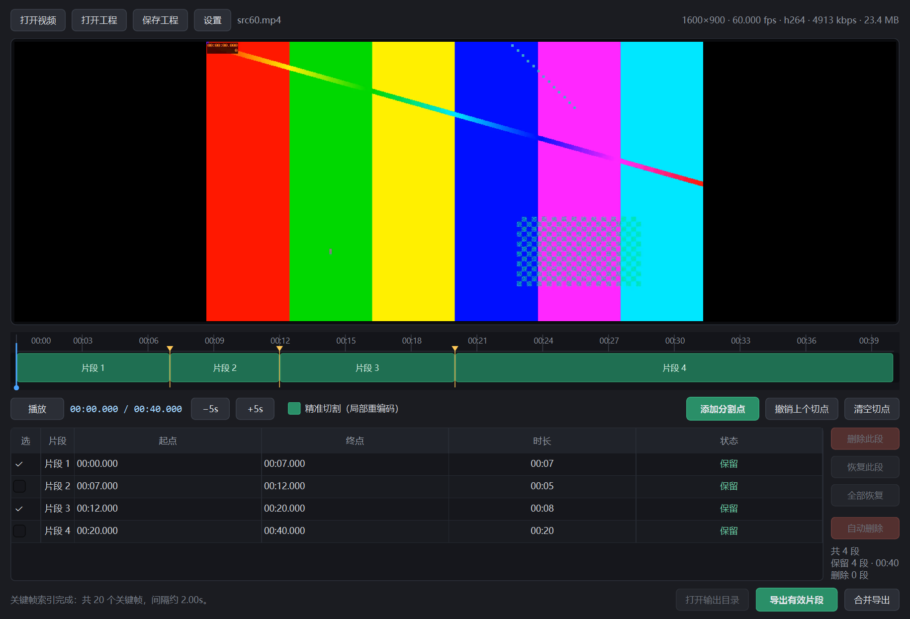
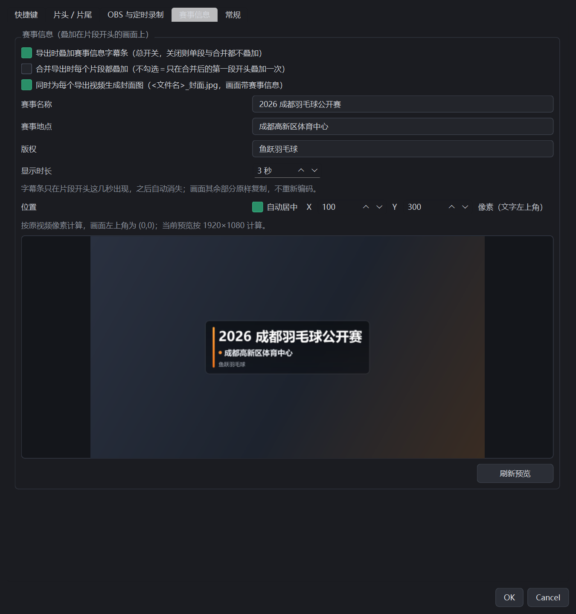
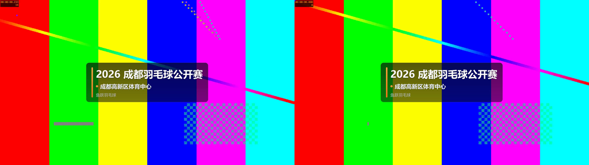
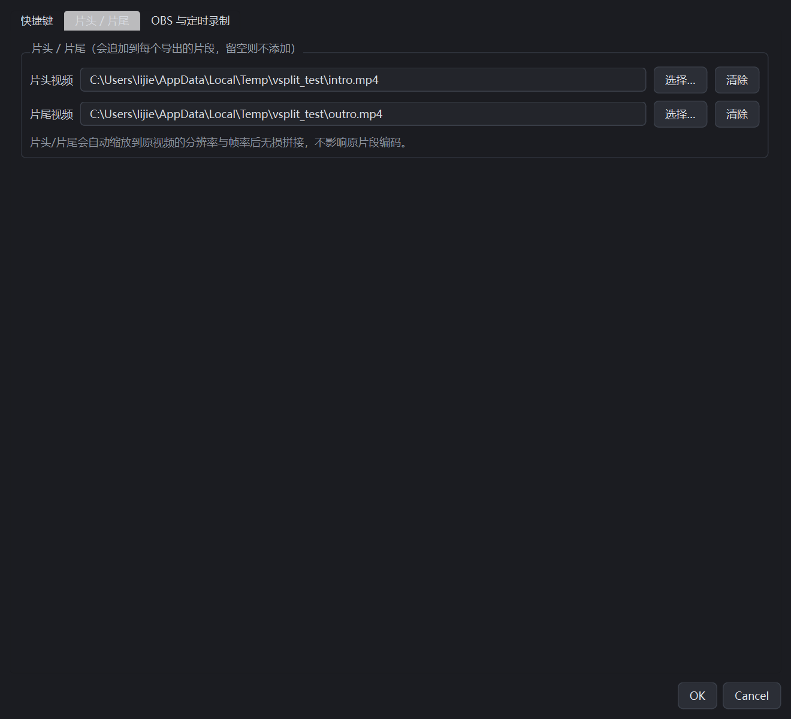

# 鱼跃快剪 · LeapingFishVideoTool

[](LICENSE)
[]()
[]()
[]()

一个给**长录制视频做"快剪"**的 Windows 桌面小工具：把录好的比赛/直播回放里不要的片段挑出来删掉，剩下的有效片段**不重新编码**直接导成独立文件；需要精确到毫秒时，只对切点附近的一小段做局部重编码。

专为 OBS 高帧率（60fps）录制素材设计，所有处理都在本地完成，不联网、不上传。

- 仓库：<https://github.com/DiveBadminton/LeapingFishVideoTool>
- 下载：[Releases](https://github.com/DiveBadminton/LeapingFishVideoTool/releases)
- 反馈：[Issues](https://github.com/DiveBadminton/LeapingFishVideoTool/issues)



## 特性

- **任意点击时间轴预览**：时间轴上单击/拖动即跳到该帧，空格播放暂停，方向键前后 5 秒。
- **切点 + 片段删除**：加切点把视频切成片段，可单段删除/恢复，也支持「自动删除」按"删一段、留一段"的规律批量标记。
- **默认零重编码**：导出走 ffmpeg 流复制（`-c copy`），画质与原片完全一致，速度接近磁盘拷贝。
- **精准切割（可选）**：打开开关后切点不再吸附关键帧，仅对"切点 → 下一个关键帧"的头部小段重编码（H.264 / CRF 18 / veryfast），其余仍原样复制。
- **批量导出**：有效片段依次导出为 `原视频名_片段1.mp4`、`原视频名_片段2.mp4`……统一放进"视频同级目录 + 与视频同名"的文件夹。
- **勾选合并导出**：片段列表带复选框，勾选的片段按顺序合成一个视频，文件名弹框自定。
- **片头片尾**：可为每个导出片段自动追加片头、片尾，先归一化分辨率/帧率/像素格式再无损拼接。
- **赛事信息字幕条**：三行文字（赛事名称 / 地点 / 版权）半透明叠加在片段开头，位置可自动居中或指定像素坐标，显示时长 1–15 秒可调；合并导出默认只在第一段出现一次。
- **视频封面**：导出时同步生成 `<文件名>_封面.jpg`（画面已叠好赛事信息）；配置了片头时还会把信息烧进片头，让文件首帧（资源管理器缩略图）也带信息。
- **工程文件**：切点、删除标记、勾选状态、精准开关、原视频路径全部自动保存为 `.vsplit`，文件名取创建时刻（如 `20261121213215.vsplit`），启动自动打开上次工程。
- **自定义快捷键**：14 个动作的按键都能在设置里改。
- **OBS 联动**：填 WebSocket 地址/端口/密码即可测试连接，并支持最多两个每日定时自动让 OBS 开始录制。
- **关闭行为可选**：点关闭直接退出，或最小化到系统托盘（不打断正在进行的导出）。

## 界面

| 赛事信息设置                                | 合并 / 封面效果                        |
| ------------------------------------------- | -------------------------------------- |
|  |  |

左图为"设置 → 赛事信息"页（含叠加总开关、合并范围、封面图开关、位置与实时预览）。右侧是导出视频首帧（左半）与自动生成的 `_封面.jpg`（右半），都带同一套赛事信息。


合并导出时，字幕条默认只在合并后的第一段开头出现（上图第一帧），后续片段保持干净。

| 片头片尾设置                                      |
| ------------------------------------------------- |
|  |

在「设置 → 片头 / 片尾」分别指定两个视频文件（留空则不追加），导出时自动加到每个片段的头尾；两者会先归一化到原片分辨率/帧率并补静音，再与片段流复制拼接。

## 快速开始

### 方式一：下载 Release 压缩包（推荐）

1. 到 [Releases](https://github.com/DiveBadminton/LeapingFishVideoTool/releases) 下载最新 `鱼跃快剪_win64.zip`（约 90MB，ffmpeg 已打进 exe，解压即用）。
2. 解压到任意目录（建议不要放在中文/超长路径的最外层），得到：

   ```
   鱼跃快剪/
   ├─ 鱼跃快剪.exe        ← 单文件，内含 ffmpeg，可直接拷走单独运行
   ├─ README.md
   ├─ LICENSE
   └─ 使用说明.md
   ```

3. 双击 `鱼跃快剪.exe`，点「打开视频」选择 OBS 录好的文件即可。**不需要另外安装 ffmpeg，也不需要 bin 目录**；exe 可以单独复制到任何位置使用。

> 若系统装了杀毒软件，首次运行单文件 exe 解压可能被启发式扫描，加白名单即可。

### 方式二：从源码运行

> 仓库里没有 `bin\ffmpeg.exe`（静态版约 100MB，超过 GitHub 单文件限制），从源码运行请自行下载后放进 `bin\`；Release 里的 exe 已经把 ffmpeg 打在包内，无需这一步。

```bash
git clone https://github.com/DiveBadminton/LeapingFishVideoTool.git
cd LeapingFishVideoTool
python -m venv .venv
.venv\Scripts\activate
pip install PySide6 websocket-client
# 把静态编译的 ffmpeg.exe 放到 bin\ 目录
python main.py
```

要求：Windows 10/11 x64，Python 3.10+（开发环境为 3.13 + PySide6 6.12）。ffmpeg 需带 `libx264`（自编译或 [BtbN](https://github.com/BtbN/FFmpeg-Builds/releases) 的 static 版均可），本程序只调用 ffmpeg，不依赖 ffprobe（时长、流信息、关键帧都从 ffmpeg 输出里解析）。

### 自行打包 / 发版

```bat
python -m PyInstaller --noconfirm --clean --onefile --windowed ^
  --icon icon.ico --name 鱼跃快剪 ^
  --add-binary "bin\ffmpeg.exe;bin" ^
  main.py
```

`--add-binary` 把 ffmpeg 打进 exe（运行时解到 PyInstaller 的临时目录，程序会自动找到）。产物是单文件 exe（约 90MB，含 Qt 运行库与 ffmpeg），可直接分发。发版时把 exe 和文档压成 zip 作为 Release 附件：

```
鱼跃快剪\鱼跃快剪.exe
鱼跃快剪\使用说明.md
鱼跃快剪\README.md
鱼跃快剪\LICENSE
```

```powershell
Compress-Archive -Path .\鱼跃快剪\* -DestinationPath .\鱼跃快剪_win64.zip
```

## 使用流程

1. **打开视频**（`Ctrl+O`）：读取时长、分辨率、帧率、编码，后台建立关键帧索引（GOP 2 秒的 40 秒素材约 20 个关键帧）。
2. **预览定位**：时间轴任意位置单击即跳转；也可以用 `←`/`→` 微调、空格试听。
3. **加切点**（`S`）：在当前位置插入一个切点，片段列表实时更新。
4. **删掉不要的片段**（`Del`）：选中行删除；规律性内容（发球间隔、广告、停顿）可用 **自动删除**（`Ctrl+Shift+D`）——从选中片段起每隔一段自动标记删除。
5. **导出**（`Ctrl+E`）：在原视频同级目录创建同名文件夹，按保留顺序输出 `原视频名_片段1.mp4` …
6. **或合并导出**：勾选需要合成的片段 → 「合并导出」→ 输入文件名，得到单个视频。

点击列表任意一行，预览会自动播放该片段（到片段末尾自动停），方便逐条核对。

## 工程文件

- 路径：**程序所在目录的 `工程` 文件夹**（与 `鱼跃快剪.exe` 同级）；若该目录不可写，退回 `文档\鱼跃快剪\工程`。
- 命名：创建时刻，例如 `20261121213215.vsplit`（JSON 文本，可直接看/改）。
- 内容：原视频绝对路径、切点列表、被删除片段索引、**勾选状态**、精准切割开关、创建时间。
- 任何改动都会自动保存；也可 `Ctrl+S` 手动写盘。启动时自动打开上次工程，原视频被移动会提示重新指定。

## 快捷键

| 默认按键       | 功能                 | 默认按键       | 功能         |
| -------------- | -------------------- | -------------- | ------------ |
| `Ctrl+O`       | 打开视频             | `Ctrl+Shift+O` | 打开工程     |
| `Ctrl+S`       | 保存工程             | `Ctrl+K`       | 设置         |
| `S`            | 添加分割点           | `Ctrl+Z`       | 撤销上个切点 |
| `Ctrl+Shift+Z` | 清空所有切点         | `Del`          | 删除选中片段 |
| `Ctrl+Shift+D` | 自动删除（隔段标记） | `R`            | 恢复选中片段 |
| `Ctrl+E`       | 导出有效片段         | `Space`        | 播放 / 暂停  |
| `Left`         | 后退 5 秒            | `Right`        | 前进 5 秒    |

「清空切点」「全部恢复」等破坏性操作会先弹确认框；所有按键均可在设置里重新绑定。

## 技术实现（简述）

- UI 用 PySide6（Qt 6）单窗口：`QGraphicsView` 画面、自绘时间轴、`QTableWidget` 片段列表，导出在 `QThread` 里跑，进度/取消不卡界面。
- 探测：`ffmpeg -i` 解析 `Duration`/流参数；关键帧用 `-skip_frame nokey -vf showinfo` 扫出来。
- 快速导出：`-ss S -t D -i src -map 0:v:0? -map 0:a? -c copy -avoid_negative_ts make_zero`。
- 精准导出：切点不是关键帧时，头部重编码到下一个关键帧（libx264 veryfast / crf18），body 复制，再 `concat` demuxer 拼接。
- 字幕条/封面：`QPainter` 画一张透明 PNG，用 `-loop 1 -i banner.png` + `overlay enable='lte(t,X)'` 只重编码开头几秒。
- 片头片尾：先 `scale/pad/setsar/fps` 归一化并补静音，再与片段一起 concat，只归一化一次、多段复用。

## 常见问题

**连不上 OBS WebSocket，报 `Handshake status 404`？**
说明这个端口上跑的不是 OBS，而是别的 HTTP 服务（例如某些视频客户端会占用 4455）。用 `Get-NetTCPConnection -LocalPort 4455` 查谁在监听，退出它或把 OBS 的 WebSocket 端口改掉，界面里填对应端口。

**连上了但认证失败？**
密码以 OBS「工具 → WebSocket 服务器设置」里的为准；另外 OBS 只监听 IPv6 时用 `127.0.0.1` 会连不到，可填 `::1`（程序会自动补方括号）。改完密码记得重启 OBS WebSocket 服务。

**导出比原片快很多，画质有损吗？**
默认模式是流复制，不重编码，画质与原片逐帧一致；只有打开「精准切割」或需要烧字幕的那几秒才局部重编码。

**为什么导出目录里多了 `_封面.jpg`？**
那是配了赛事信息后自动生成的封面图（画面带三行赛事信息）。不想生成就在设置 → 赛事信息里取消「同时为每个导出视频生成封面图」。

**字幕条只在开头几秒出现？**
这是设计如此：字幕条只覆盖片段开头（默认 3 秒），之后的画面原样复制，避免全片重编码拖慢速度、损失画质。

**exe 启动报找不到 ffmpeg？**
Release 里的 exe 已内置 ffmpeg，可单独运行；若你自行打包且没加 `--add-binary`，则需要把 `bin\ffmpeg.exe` 放在 exe 同级 `bin` 目录（程序也支持这种外置方式，优先级高于内置）。

**杀毒软件报毒 / 首次启动慢？**
单文件 PyInstaller 包在解压临时目录时可能被启发式扫描，属常见误报，可加白名单；exe 内含 ffmpeg，首次启动要把约 100MB 解到临时目录，通常几秒，第二次启动视系统缓存而定。

## 目录结构

```
LeapingFishVideoTool/
├─ main.py               # 全部源码（单文件）
├─ icon.ico              # 程序图标
├─ bin/ffmpeg.exe        # 视频处理引擎（源码运行需要；Release 的 exe 已内置）
├─ 工程/                  # 自动保存的 .vsplit 工程（本地生成）
├─ docs/images/          # README 配图
├─ README.md
├─ LICENSE               # MIT
└─ 使用说明.md            # 面向使用者的中文手册
```

## 已知限制

- 仅 Windows（代码里用了 `CREATE_NO_WINDOW`、`os.startfile` 等，Linux/macOS 需自行适配）。
- 单文件 exe 内含 ffmpeg（约 100MB），每次启动要先解包到临时目录，首次启动通常需要几秒。
- 精准切割的切点落在关键帧之间时，会连带重编码到下一个关键帧（GOP 越大，重编码段越长）。
- 片头片尾若与原片分辨率/帧率差异过大，会先缩放补边，不做智能裁切。
- 字幕条字体使用系统中文字体（微软雅黑/思源黑体等），缺失时回退默认字体，排版可能略有差异。

## 贡献

欢迎 [Issue](https://github.com/DiveBadminton/LeapingFishVideoTool/issues) / PR：报 Bug 时请附上 OBS 版本、ffmpeg 版本（`ffmpeg -version`）、素材的 `ffmpeg -i` 输出和程序状态栏提示。改动请保持"单文件源码 + 无额外依赖"的风格。

## 许可证

本项目采用 [MIT License](LICENSE) 授权。使用本工具处理素材时，请自行确保对录制内容拥有相应权利（例如赛事版权方要求）。

---

### English

**LeapingFishVideoTool** is a small Windows GUI for fast trimming of long recordings (built for OBS 60fps footage). Mark split points on a clickable timeline, delete unwanted segments, and export the rest as separate files with **no re-encoding** (stream copy), or use _precise cut_ to re-encode only the head up to the next keyframe. It also supports batch merge of selected segments, intro/outro, a configurable three-line event caption (with auto-generated cover images), auto-saved `.vsplit` projects, custom shortcuts, and OBS WebSocket scheduling. Built with PySide6 + ffmpeg, runs fully offline on Windows 10/11.

